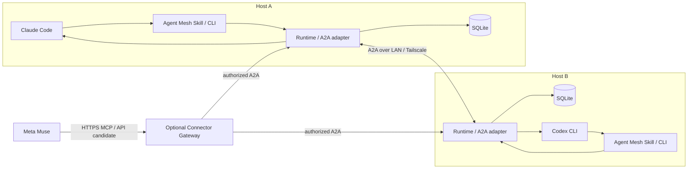
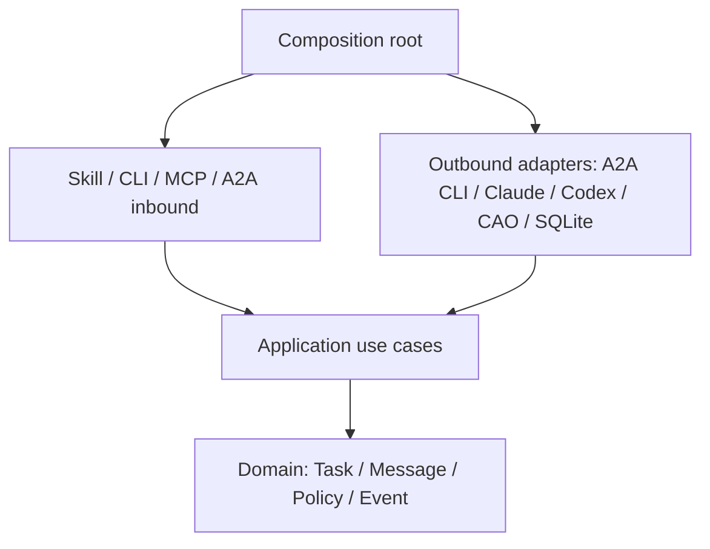

# Agent Mesh 基本設計仕様書

| 項目 | 内容 |
|---|---|
| 文書ID | AM-BD-001 |
| 版 | 0.1.0（調査反映・実装前レビュー版） |
| 作成日 | 2026-11-24 JST |
| 対象 | 個人利用向け分散型エージェント連携基盤 |
| 関連文書 | [機能設計](03-functional-design.md) / [詳細設計](02-detailed-design.md) / [インターフェース仕様](04-interface-design.md) |

## 1. 背景・目的

Claude Code、Codex CLI、Meta Museを対等なエージェントとして扱い、必要に応じて他のエージェントに仕事を依頼し、別の作業を続けながら結果を受け取れる環境を構築する。特定のLLMやオーケストレーターを必須の司令塔としない。CLIの既存サブスクリプション認証を利用し、別途の推論APIキー・従量課金契約を要求しない。A2A/MCPなどの通信APIの利用はこの制約に抵触しない。

成功条件は、利用者がサーバーやDBを手作業で構築する必要がなく、最小構成から必要な機能のみ追加できること。完了待ちのためにLLMを定期起動しないこと。

## 2. 要件と範囲

| ID | 要件 | 優先度 |
|---|---|---|
| R01 | Claude Code・Codexの相互依頼、対等な送受信 | Must |
| R02 | Agent Skillsによる配布、CLIの共通操作 | Must |
| R03 | タスク受領後に依頼元が別作業を継続 | Must |
| R04 | 完了イベントで安全なタイミングに依頼元を再開。LLMポーリング禁止 | Must |
| R05 | LAN/Tailscaleで異なるホスト間を接続 | Must |
| R06 | Runtime・Connector・CAOを個別選択し、手動サーバー構築なし | Must |
| R07 | A2A標準準拠・版差吸収、独自プロトコルを最小化 | Must |
| R08 | CLIの正規認証・権限制御を維持 | Must |
| R09 | Museからカスタムコネクターで依頼、結果参照 | Should（実機検証後） |
| R10 | Museへのイベント起点の推論再開 | Could（公式入口が確認できる場合のみ） |
| R11 | 永続化・再起動復旧・重複防止・監査・停止操作 | Must |
| R12 | 個別配布と公式ディレクトリ掲載を分離 | Should |

対象外：LLM学習、独自モデルAPIプロキシ、認証トークンの抽出・転送、消費者向けWeb UIの非公開API利用、無制限の自律再帰、初版からのマルチテナントSaaS。Museは初期設計に含めるが、CLI 2種の初回動作検証を先行する。

## 3. 既存ツール調査と採用判断

調査方法：2026-11-24時点の公開公式ドキュメント・公開リポジトリのREADME、仕様、リリース情報を確認。コードの全行監査、固定コミットでの実行、実際の契約アカウントによる疎通は未実施。下表の「確認」は文書上の機能確認であり、本製品の動作保証ではない。

| 候補 | 文書で確認できた事項 | 判断・検証課題 |
|---|---|---|
| A2A CLI [S1–S3] | A2A 1.0/0.3、Skill、JSON出力、非同期送信、購読、プッシュ通知機能 | **第一候補・依存利用**。実行可能バイナリを別途導入。対象版のJSON・通知契約を検証 |
| CLI Agent Orchestrator (CAO) [S4–S7] | 認証済みCLI、セッション管理、イベントプラグイン、Herdrのイベント駆動配信 | **第二候補・オプションアダプター**。cao-server等の依存・既存対話セッションへの配信を検証 |
| A2A Serve [S8–S10] | ACP対応エージェントを公開、ネットワーク接続・Skill/MCP | 受信サーバー候補。Claudeの導入例はAPIキー使用。サブスク認証・Codex ACP・サンドボックス適合が不明のため必須依存にしない |
| AgenticMail [S11] | Claude/Codex間のメール配送とホスト別起動 | 設計調査対象。受信箱・ディスパッチ・重複防止・セットアップの考え方を分析。MIT表示 |
| multiagents [S12] | MCP、ブローカー起動、Claude/Codex/Geminiチーム | 設計調査対象。メッセージ配送・CLI検出・セットアップを分析。MIT表示 |
| Muse Connector Platform [S13–S15] | 個別コネクター作成、API/MCPでの公式掲載申請、承認モデル | 外部接続アダプター。個別MCP接続方式・外部イベントによる起動は未確認 |

重要な訂正：以前の検討ではA2A CLIの送信は待機型と整理したが、待機はデフォルト動作であり `--async` が存在する。Skill自身はサーバーを提供せず、バイナリのインストールも行わない。非同期タスク送信を再発明せず、永続化・起動制御に拡張を集中する。

### 3.1 再利用方針（ADR）

| ADR | 決定 | 理由・代替 |
|---|---|---|
| ADR-01 | A2A CLIをまず外部コマンドとして利用 | forkを避け、版固定・契約テスト。CLIで不足する受信処理は公式SDK候補 |
| ADR-02 | CAOを任意の実行バックエンドとする | セッション管理を再利用、単純なCLI実行には不要 |
| ADR-03 | AgenticMail/multiagentsは公開実装分析から独立仕様を作る | 必須依存を増やさない。コード再利用はライセンス審査後 |
| ADR-04 | Node.js/TypeScript LTS + SQLiteを初版候補にする | 非同期I/O・配布・型安全。利用者の指定ではなく設計提案 |
| ADR-05 | P2P型のアプリケーション構造、ホストごとにRuntime | 単一司令塔不要。クラウド接続用中継は任意 |
| ADR-06 | Skill First / Zero Manual Server Setup | バックグラウンド受信が必要なときだけローカルサービスを自動導入 |
| ADR-07 | 既存CLIログインを維持し、推論APIキーを要求しない | 正規CLIを同じOSユーザーで起動。利用条件・プラン上限に従う |
| ADR-08 | Museの受信起動を初版保証から外す | 外部コネクターのツール呼出とMuse自身の新規ターン起動は異なる |

## 4. 構成・星取表

S = Skill + A2A CLI（送信クライアント、通信先は別途稼働）。R = Skill + ローカルRuntime（受信・起動を追加）。C = Connectorモジュールのみ（接続先バックエンド別途必要）。RC = R + C。○＝設計上対応、△＝条件付き/未検証、×＝単独不可、—＝対象外。実装済みの評価ではない。

| 機能 | S | R | C | RC |
|---|:---:|:---:|:---:|:---:|
| 手動でのサーバー構築不要 | ○ | ○ | △ | △ |
| ローカル常駐プロセス不要 | ○ | × | △ | × |
| 外部ホスティング契約不要 | ○ | ○ | △ | △ |
| Claude/CodexからのA2A送信 | ○ | ○ | — | ○ |
| 非同期送信・ID取得 | ○ | ○ | △ | ○ |
| 明示的な結果取得 | ○ | ○ | △ | ○ |
| エージェントを受信先として公開 | × | ○ | × | ○ |
| 別作業中の結果の永続受信 | × | ○ | × | ○ |
| アイドル時の自動推論再開 | × | △ | × | △ |
| 実行中の安全なターン終了後の取り込み | × | △ | × | △ |
| LAN/Tailscale相互通信 | △ | ○ | △ | ○ |
| 既存CLIサブスク利用 | △ | △ | — | △ |
| Museから依頼・状態確認 | × | × | △ | △ |
| Museへの外部イベントによる自動起動 | × | × | △ | △ |
| 外部公開なしでCLI間運用 | ○ | ○ | △ | △ |
| モジュール個別インストール | ○ | ○ | ○ | ○ |

Sでも非同期送信後に別作業可能。ただし送信元が終了中の自動受信は保証しない。サーバーレスとは「利用者側に常駐受信プロセスがない」意味であり、A2A接続先の存在は必要。Cは独立した配布単位であって単独で動く受信基盤ではない。

## 5. システム構成

Runtimeは各ホストのユーザー権限で起動。ノードの受信は一律に有効化せず、公開するエージェント・作業ディレクトリを選ぶ。Muse向けは既定で無効。Tailscale Serveはtailnet内部のみ、Funnelは公開インターネットへ露出するためデフォルト禁止 [S16]。クラウド上のMuseがtailnetへ直接接続できるとは仮定しない。公開Gatewayを選ぶ場合は認証と明示同意を必須とする。

### 5.1 Clean Architecture / Ports and Adapters

矢印はソースコードの依存方向。Domainは外部フレームワーク・DB・プロセス・A2Aに依存しない。ApplicationがPortを定義し、外側が実装する。Composition Rootのみ具体実装を組み合わせる。Skillは操作ガイドでありビジネスロジックを複製しない。

### 5.2 GoFの適用

| パターン | 採用 | 適用箇所 |
|---|---|---|
| Adapter | ◎ | CLI/MCP/A2A、CAOと各プロバイダーの変換 |
| Command | ◎ | SendTask、DeliverEvent、ResumeSessionのユースケース |
| Observer | ◎ | イベント購読。プロセス間の配送は別途A2A SSE/Webhook |
| Strategy | ◎ | Direct/CAO実行、Push/SSE購読方式 |
| State | ○ | タスク状態遷移。不変条件を純粋関数から始める |
| Facade | ○ | mesh CLI/MCPの一貫した操作 |
| Factory Method | △ | 生成処理が複雑化した場合のみ |
| Mediator | △ | ホスト内調停のみ。中央司令塔は必須化しない |

クラスの乱立より小さな関数と明示的Portを優先する。パターンの採用そのものを目的にしない。

## 6. 非機能設計

目標値は暫定で、初回ベンチマークで更新する。前提は1ユーザー・最大10論理エージェント/ホスト、同時実行2セッション/ホスト。

| ID | 目標 |
|---|---|
| N01 | 前提ツールがある状態で導入1コマンド＋必要な承認/ログイン、5分以内を目標 |
| N02 | 健全なLAN/Tailscaleでタスク受領ACK p95 2秒以内（推論時間除外） |
| N03 | 完了イベント受信→永続化 p95 1秒以内、アイドルかつ許可済み→起動要求 p95 5秒以内 |
| N04 | ローカルRuntime待機時RSS 150MiB以下を目標（外部CLI/CAO除外） |
| N05 | プロセス停止後、受領済みタスク・通知を復元。配送はat-least-once、重複処理を抑止 |
| N06 | TLS・認証・スコープ・ワークスペース制限、機密ログ非出力 |
| N07 | CLI版差を契約テストで検出、非対応機能は明示的に拒否 |
| N08 | macOS/LinuxをP0、WindowsはWSL2をP1、ネイティブはP2（検証後） |

## 7. 配布・運用

- Skill Only：GitHubからSkillを導入、A2A CLIとmesh CLIの存在を確認。常駐・公開・DB起動は不要（小規模なローカル設定ファイルは許可）。
- Runtime：明示的な `mesh setup --runtime` でサービス登録を自動化。launchd/systemd userを候補とする。Docker、DBサーバー、CAOは必須にしない。
- CAO：既存環境へのアダプター追加。CAO serverを自動導入する場合も事前確認、不要ならDirect実行。
- Connector：個別セットアップ用の説明・公開MCP/API・認証手順を提供。公式掲載は別工程。Muse対応の詳細はIF仕様書。
- 更新は固定バージョンの署名/チェックサム検証、設定バックアップ、ロールバック、削除時のデータ保持選択。

## 8. 開発順序・リリースゲート

| Gate | 作業 | 合格条件 |
|---|---|---|
| G0 調査 | 上流コミット固定、コード経路/ライセンス調査、CLIログインでPoC | A2A async JSON、Claude/Codex再開、利用条件、通知契約を記録 |
| G1 Skill | 共通CLI・Skill・設定、既存A2Aへ送信 | サーバーなし構成で送信と手動結果取得 |
| G2 Runtime | 受信、永続化、イベント、再開、LAN/Tailscale | 両CLIの双方向、自動再開、別作業継続、クラッシュ復旧 |
| G3 CAO | CAO制御・イベントプラグイン | 実行バックエンド選択、同一セッション競合防止 |
| G4 Muse | 個別Connectorの接続・権限・結果取得 | 正規UIから送信、結果参照、アクセス取消を検証。未確認のwakeは非提供 |
| G5 配布 | 自動インストール/解除、監査、ドキュメント | 依存選択・回帰・障害試験合格 |

## 9. 未解決事項

- Q01: A2A CLIの固定版・非同期とプッシュ通知の同時利用時の具体的契約、各サーバーの能力差。
- Q02: Claude/Codexの対象プラン・認証状態での非対話実行および自動再開、利用規約上の許容範囲。
- Q03: 対話中のターン完了検知・安全な投入。CAO/Herdr、Codex App Server、Claude Hooksを検証。
- Q04: Muse個別ConnectorがリモートMCPを受け付ける手順、OAuth、公開ネットワーク要件、日本でのアカウント利用可否。
- Q05: Museへの外部起動/メール受信トリガー。メール到達を推論開始と同一視しない。
- Q06: A2A Serveのサブスク認証、CodexとのACP適合、各候補の正確なコミットと推移依存ライセンス。
- Q07: Node.js/SQLite配布形態、公開Gatewayの運用者と費用、ライセンス選定。

## 10. 調査出典（2026-11-24閲覧）

- S1 [A2A CLI repository](https://github.com/a2aproject/a2a-cli) / S2 [CLI specification](https://github.com/a2aproject/a2a-cli/blob/main/specification/SPEC.md) / S3 [Official Skill](https://github.com/a2aproject/a2a-cli/blob/main/skills/a2a-cli/SKILL.md)
- S4 [CAO repository](https://github.com/awslabs/cli-agent-orchestrator) / S5 [Control planes](https://github.com/awslabs/cli-agent-orchestrator/blob/main/docs/control-planes.md) / S6 [Releases](https://github.com/awslabs/cli-agent-orchestrator/releases) / S7 [Agent plugins](https://github.com/awslabs/cli-agent-orchestrator/blob/main/docs/agent-plugins.md)
- S8 [A2A Serve](https://a2aproject.github.io/a2a-serve/) / S9 [Getting started](https://a2aproject.github.io/a2a-serve/getting-started/) / S10 [Supported agents](https://a2aproject.github.io/a2a-serve/guide/supported-agents/)
- S11 [AgenticMail](https://github.com/agenticmail/agenticmail) / S12 [multiagents](https://github.com/zetbrush/multiagents)
- S13 [Muse help: Connectors](https://www.meta.com/en-gb/help/superintelligence/1687253048996149/) / S14 [Connector guidelines](https://platform.muse.ai/docs) / S15 [Connector terms](https://platform.muse.ai/terms)
- S16 [Tailscale Serve](https://tailscale.com/docs/features/tailscale-serve) / [Funnel](https://tailscale.com/docs/features/tailscale-funnel)
- S17 [A2A specification](https://a2a-protocol.org/latest/specification/) / [v0.3](https://a2a-protocol.org/v0.3.0/specification/)
- S18 [Agent Skills specification](https://agentskills.io/specification)
- S19 [Claude CLI](https://code.claude.com/docs/en/cli-reference) / [Non-interactive](https://code.claude.com/docs/en/headless) / [Hooks](https://code.claude.com/docs/en/hooks)
- S20 [Codex CLI](https://learn.chatgpt.com/docs/cli/reference) / [Non-interactive](https://learn.chatgpt.com/docs/non-interactive-mode) / [App Server](https://learn.chatgpt.com/docs/app-server) / [Skills](https://learn.chatgpt.com/docs/build-skills)
- S21 [MCP transports](https://modelcontextprotocol.io/specification/latest/basic/transports) / [Authorization](https://modelcontextprotocol.io/specification/latest/basic/authorization)
- S22 [GoF catalog](https://refactoring.guru/design-patterns/catalog)（設計用参考）

動的なmain/latest参照はG0でコミット・版を固定する。仕様書の製品名・CLI名 `Agent Mesh` / `mesh` は仮称。
