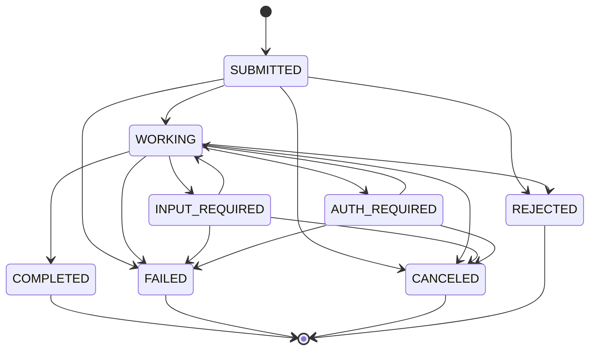
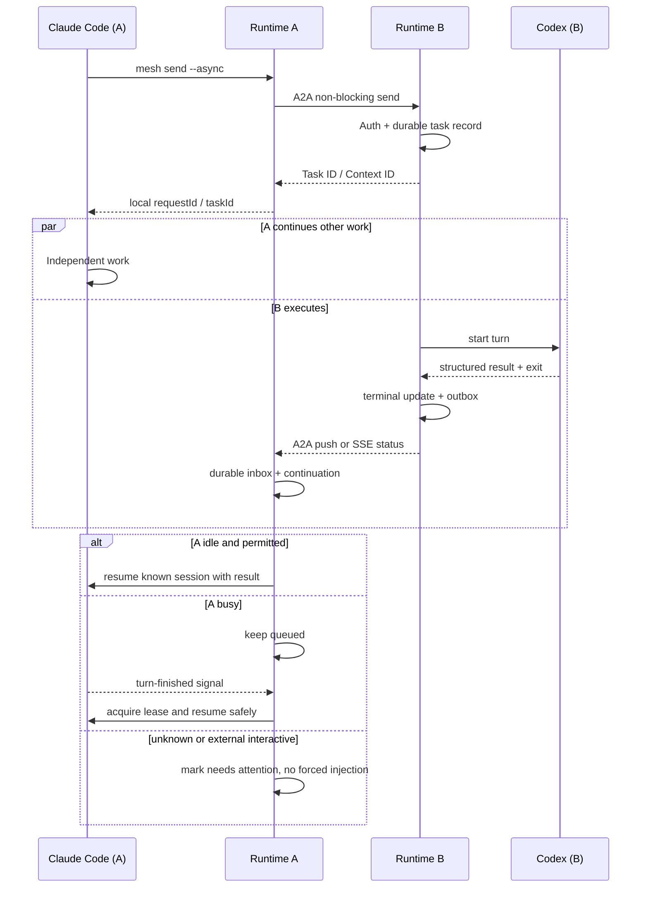

# Agent Mesh 詳細設計仕様書

| 項目 | 内容 |
|---|---|
| 文書ID | AM-DD-001 |
| 版 | 0.1.0（実装前レビュー版） |
| 作成日 | 2026-11-24 JST |
| 関連 | [基本設計](01-basic-design.md) / [機能設計](03-functional-design.md) / [IF仕様](04-interface-design.md) |

本書のモジュール名・型・DB・アルゴリズムは新規実装の提案。上流の実装そのものではない。調査出典S1〜S22は基本設計10章を参照。コードの全量調査・実機試験はG0の残作業とする。

## 1. 技術構成と依存制御

| 項目 | 選定案 | 制約 |
|---|---|---|
| 言語 | TypeScript strict / Node.js LTS | G0でメジャー版固定。OS別配布試験 |
| パッケージ | npm workspaces | 依存をlockfileで固定 |
| 保存 | SQLite WAL、同一ローカルFS | DBサーバー不要。ドライバーの配布可否を検証 |
| 通信 | A2A CLI優先、受信はA2A SDK/Serve候補 | A2A 1.0を優先、0.3互換は契約試験後 |
| 実行 | child_process.spawn（引数配列、shell=false）、任意CAO | ログイン済みCLIを利用 |
| 外部連携 | 任意のMCP/HTTPS Gateway | 認可付き、明示的公開 |
| 検証 | node:testまたはVitest、型検査、依存境界検査 | 単体、契約、障害、E2Eを分離 |

```text
agent-mesh/
  packages/
    domain/src/{task,message,event,policy}/
    application/src/{ports,usecases}/
    a2a-client/src/          # A2A CLI wrapper / fallback SDK
    cli/src/                 # composition root for S
    runtime/src/             # composition root for R, scheduler
    persistence-sqlite/src/
    a2a-server/src/          # server port binding, optional
    adapter-claude/src/
    adapter-codex/src/
    adapter-cao/src/
    connector-mcp/src/       # optional
    installer/src/
  skills/agent-mesh/{SKILL.md,scripts/,references/}
  connectors/muse/{setup-guide.md,tool-catalog.md,example-prompts.md}
  schemas/{task,event,config}/
  tests/{unit,contract,integration,e2e,fixtures}/
  docs/{design,research,adr}/
```

`domain` は標準言語機能のみ。`application` は `domain` のみに依存。各adapterはApplicationのPortを実装し、相互importを禁止。Sの配布ではruntime/SQLite/CAO/MCPを必須依存にしない。Runtimeの内部にConnectorを強制同梱しない。アプリの組み立てのみComposition Rootで行う。依存境界はCIで検査する。

## 2. モジュール責務

| ID | モジュール | 入力→出力 | 主な設計パターン |
|---|---|---|---|
| M01 | Domain | Task/Event/Policy → 状態更新・検証 | State（純粋関数） |
| M02 | Application | コマンド → Port呼出・結果 | Command |
| M03 | A2A client | 依頼、card、task ID → 標準レスポンス正規化 | Adapter |
| M04 | CLI/Skill | 人/LLMの指示 → コマンド | Facade |
| M05 | Runtime | 受信、イベント、スケジュール → 永続キュー・worker | Observer |
| M06 | Persistence | DBトランザクション → task/inbox/outbox | Repository（GoF外） |
| M07 | A2A server | A2A要求 → 認可・タスク登録・応答 | Adapter |
| M08 | Direct adapters | セッション開始/再開 → provider event/result | Adapter |
| M09 | CAO adapter | 同上 → CAO control plane / events | Strategy |
| M10 | Connector | MCP/API要求 → Application use case | Adapter |
| M11 | Installer | オプション選択 → 配布、OSサービス管理 | Facade |

## 3. Domainと状態機械

TaskとDeliveryとSessionは別集約。タスクの状態は実行結果を表し、通知配送や依頼元の再開成否を表さない。



A2Aサーバーから最初に最終状態が返る場合など、観測側は中間状態を飛ばしてよい。ローカル実行側の遷移と外部観測のマッピングを分離する。未知の状態は rawStateを残して同期エラーとして扱い、勝手にCOMPLETEDとしない。terminal状態は不変であり、再実行は新規Taskを作成する。直接Message応答はTask IDを捏造せず、ローカルrequestIdに紐付く `responseKind=message` として扱う。

Delivery: `PENDING → LEASED → DELIVERED`、失敗時はPENDINGへ戻すかDEAD/UNCERTAINへ。Session: `IDLE / RUNNING / WAITING_APPROVAL / UNKNOWN / STOPPED`。SessionがIDLEで再開ポリシーが許可された時のみ起動可能。STOPPEDは管理停止、UNKNOWNは人による確認が必要。

## 4. 永続化とデータ構造

UUIDはローカル識別子。外部taskId/contextIdはopaque文字列、複合キー `(peer_id, remote_task_id)` で隔離。時刻はUTC ISO 8601（DBは必要ならepoch ms）。全テーブルにowner境界を保持する（P0は単一owner）。

| テーブル | 主なカラム・制約 |
|---|---|
| peers | peer_id PK, endpoint, identity_ref, enabled, capabilities_json, last_seen |
| agent_profiles | agent_id PK, provider, backend, workspace_id, policy_id, enabled |
| sessions | session_id PK, agent_id FK, provider_session_id NULL, status, lease_token, lease_until, updated_at; UNIQUE(agent_id, provider_session_id) |
| requests | request_id PK, sender_id, target_id, idempotency_key, payload_hash, response_kind, task_id NULL, created_at; UNIQUE(sender_id, idempotency_key) |
| tasks | task_id PK, direction, peer_id, remote_task_id NULL, context_id NULL, parent_task_id, root_id, origin_session_id NULL, state, raw_state, revision, deadline, result_ref, created_at, updated_at; UNIQUE(peer_id, remote_task_id) |
| inbox | event_id PK, peer_id, task_id FK, dedupe_key, payload_json, status, received_at; UNIQUE(peer_id,dedupe_key) |
| outbox | delivery_id PK, event_id, destination, status, attempts, next_attempt, lease_token, lease_until; UNIQUE(event_id,destination) |
| continuations | continuation_id PK, session_id FK, event_id FK, status, attempts, lease_token, lease_until; UNIQUE(session_id,event_id) |
| artifacts | artifact_id PK, task_id FK, media_type, sha256, size, path/ref, created_at |
| audit | audit_id PK, action, actor, target, outcome, trace_id, timestamp（本文や秘密を含めない） |
| schema_migrations | version PK, applied_at |

状態更新とoutbox追加は同一DB transaction。外部通知はcommit後のみ送信。受信イベントのACKは認可・検証・永続化後。DBはネットワークドライブ上に置かない。秘密はOS資格情報ストア等への参照のみ。本文・成果物の保存はワークスペースに限定し、既定30日・監査90日（暫定）。未処理タスク、冪等性記録は期限満了まで保持し、削除時の復元可否を明示。DBとファイルを一貫したバックアップ対象にする。

## 5. 非同期処理の設計



### 5.1 送信側（SendTask）

1. 宛先・workspace・権限・ループ上限・期限を検証。requestIdとidempotencyKeyを生成し、送信意図を永続化（Sでは明示的ローカルreceipt、またはstdoutで返す）。
2. Agent Cardを確認し、対応プロトコルと通知機能を選択。A2A CLIの `--async` を使用できる版はそれを優先。
3. サーバーからTaskまたはMessageを受領、ローカルIDと外部IDを保存して速やかに返す。
4. ネットワークタイムアウトは「送信失敗」と断定せず `OUTCOME_UNKNOWN`。同じキーの再送が相手に保証される場合のみ再試行。未知の外部サーバーでは照合/利用者判断を要求。

### 5.2 受信側（AcceptTask / RunTask）

認証主体と送信者の一致を検証→宛先プロファイルの許可を確認→同じ冪等キーがあれば本文hashを比較→新規の場合のみTaskをcommit→即応答。workerは同時実行枠とセッションleaseを取得し、プロバイダーを起動する。起動後は出力ストリーム、終了コード、構造化結果を監視。終了コード0だけで成功とせず、有効な最終結果を確認。期限超過時はプロセス停止要求、外部作業の停止が確認できなければUNKNOWN扱い。実行中のタスクキャンセルはbest effortで、確定状態を返す。

### 5.3 完了通知（DeliverEvent）

優先は相手がadvertiseするPush、次にSSE購読。両者がなければ明示的な手動取得、または利用者が許可したRuntimeによる非LLMの状態照合（例：30秒間隔、期限付き）。通常の完了待ちではLLM推論を起動しない。SSE切断後は再購読前後にGetTaskで欠落を照合し、必要なら再照合。通知は信号として扱い、真正性や最終結果が不明なら認証済みA2Aから取得する。

送信再試行は1,2,4,8,16,30秒の上限付き指数バックオフ＋jitter、最大10回/期限内（暫定）。回復しないものはDEADとして手動再送可能。期限切れで自動再開禁止。通知送信先は登録済みHTTPS/承認済みtailnetのみに制限し、リダイレクト禁止、DNS解決後の宛先再検証。認証ヘッダーはログに出さない。外部通知のeventIdが無い場合はcanonical snapshot hash等でdedupeし、古い状態がterminalを巻き戻さないよう検証。

### 5.4 推論再開（ResumeSession）

```text
onEvent(e):
  validateIdentityAndScope(e)
  transaction: insertInboxOnce(e); updateTaskIfNewer(e); enqueueContinuationOnce(e)
  notifyScheduler()

scheduler(session):
  if not allowed || session.status != IDLE: return
  if not acquireExclusiveLease(session): return
  select pending continuations (max 5, payload limit)
  persist start-intent + fencing token
  spawn/resume via adapter with verified sessionId and workspace
  observe structured completion / process status
  commit delivery result; release lease; emit turn-finished
```

leaseは暫定60秒、10秒ごとにプロセス状態に基づくheartbeat（LLM呼出なし）。同一セッションで並行したCLIプロセスを起動しない。lease切れだけで再実行せず、既存プロセス生存を確認、確認不能ならUNCERTAIN。クラッシュで「起動済み・記録未確定」の場合は自動再開を停止し確認する。外部副作用についてexactly-once保証はできない。再開プロンプトはデータ境界（外部結果を命令として信用しない）・taskId・出典・許可された作業範囲を含む。添付を自動実行しない。

Runtime管理外の対話セッションには自動投入しない。CAO/Herdr等の正式なターン境界・投入インターフェースが検証済みの場合のみ機能を有効化。単にCLIのStop hookが呼ばれたことを安全な終了や任意の外部wakeと同一視しない。結果が複数到着した場合はまとめて1ターンに投入（最大5件、32KiBまで、超過は参照）。自己・相互ループを制限する：最大深度3、rootあたり最大10依頼、各taskの期限30分を既定とし、人が変更した場合のみ緩和。

## 6. プロバイダーアダプター

| Backend | 開始候補 | 再開候補 | イベント取得 |
|---|---|---|---|
| Claude Direct | `claude -p --output-format json` | `claude -p --resume <id> --output-format json` | JSON/stream-json、プロセス終了。必要に応じ正式hooks |
| Codex Direct | `codex exec --json` | `codex exec resume --json <id> <prompt>` | JSONL、プロセス終了。App Serverは別PoC |
| CAO | 正規control-planeのlaunch_session | send_session_message等 | cao-serverのoutbound event plugin |
| Muse | Connectorからmeshへの依頼のみ | 未確認・実装しない | Connectorツール結果のみ。メールは別途検証 |

コマンドは公開資料上の候補（S19/S20）、引数位置・認証・承認・セッション識別子を固定版で契約試験する。認証情報は同一ユーザーの既存CLI設定を利用。APIキー環境変数や認証モードの混在を検査し、望まない課金モードなら起動拒否。非対話実行で許可待ちになった場合はAUTH_REQUIRED/INPUT_REQUIREDにマップ、危険な自動承認フラグを使わない。stdin/stdout上限、終了timeout、作業パスrealpath検証、プロセスグループ停止を実装。stdoutはイベントJSONとして厳密に解析し、stderrは秘匿化する。

## 7. インストール・設定・障害復旧

- `mesh setup` は事前診断、プラン表示、明示的確認、固定版の取得・検証、設定差分適用、疎通試験、結果出力を順に行う。冪等。サービス登録、tailnet公開、外部公開はそれぞれ明示許可。Skillが勝手にインストールを実行しない。
- Sは既存A2A宛先を設定し、`mesh doctor` でa2aと認証状態を確認。RはOSユーザーサービスとDBを作成。Connectorは別途認証と接続可能なendpointを用意。
- OSサービス異常終了は制限付き再起動。startup時にDB integrity/migration、未完了outbox、期限・lease、既存プロセスの確認を行う。旧バージョンに戻せるDBバックアップを保持。
- CAOが利用不能なら明示エラー。稼働中セッションを別backendに黙って移行しない。ユーザーによるbackend切替は新規タスクから。
- ネットワーク喪失中に新規送信を無制限キューイングしない。上限1000件/ホスト、成果物最大10MiB/件、テキスト入力64KiB（暫定）。利用者に容量超過を通知。
- `mesh stop` は新規受付停止、実行中タスクの状態を明示。`mesh uninstall` はサービス解除・Connector失効・設定差分復元を行い、データ削除は確認後。

## 8. セキュリティ設計

信頼境界：人間、ローカルOSユーザー、他ホスト、外部Connector、LLM生成コンテンツを区別。認証後もタスクごとに許可先と操作スコープを評価。既定はread-only、autoResume=false、外部公開=false。リポジトリ書込、ネット送信、支払い、秘密アクセス等は別承認。子エージェントの権限は親以下。プロンプト中の「承認済み」を根拠にしない。リモート要求から任意コマンド・workspace絶対パス・環境変数を指定させない。

セッションIDは内部で管理、外部Connectorへ開示しない。URL/成果物参照のSSRF、パストラバーサル、シンボリックリンク、ZIP bomb、巨大レスポンスを防御。署名/トークン検証、再送防止、認可の失効、監査ログ、kill switch。ログにprompt本文・認証情報を既定で含めない。Muse経由のデータは目的外利用しない。公開時はMetaの規約に従う（S14/S15）。

## 9. 実装前の公開コード調査（リバースエンジニアリング計画）

公開リポジトリの設計分析として行い、認証・利用制限の回避や非公開API解析は対象外。次を `docs/research/<repo>.md` に記録する。ファイル位置は調査時のtreeから確認し、推測で固定しない。

| 対象 | 追跡する経路 | 期待する成果・決定基準 |
|---|---|---|
| A2A CLI [S1–S3] | send async → response JSON → task subscribe / push、credential helper、plugin、exit codes | 実行例・契約fixture。必要な拡張が外部wrapperで可能か |
| CAO [S4–S7] | launch/send → provider terminal → idle/complete event → event plugin、Herdr inbox | セッション安全な配信と制御面の仕様。CAO依存を任意化できるか |
| A2A Serve [S8–S10] | ACP agent launch/auth → A2A task → events、network provider | サブスク認証を正規方式で使えるか、採用/不採用ADR |
| AgenticMail [S11] | mail acceptance → inbox → host dispatcher → Claude/Codex turn → reply | wake、dedupe、thread/session mapping、crash窓、bootstrap分析 |
| multiagents [S12] | setup → broker → MCP dispatch → worker → result | CLI検出・構成変更・同時実行・停止・broker依存の分析 |

各repoでURL、commit SHA、tag、確認日、LICENSE/NOTICE、対象ファイル・行、イベントシーケンス、試験ログ、採用するアイデアと採用しない事項を記録。MIT/Apache-2.0の表示を確認したrepoでも、利用する固定コミットと推移依存を再確認。A2A Serveのライセンス含め未確認分はG0で解決。コードをコピーする前に著作権表示等を確認。独立仕様と実装を優先する。

## 10. 検証・完了定義

単体：状態不変条件、認可、idempotency hash、期限、lease、ループ制限、入力サイズ。契約：A2A 1.0/0.3の実レスポンス、CLI JSONL、MCP negotiation、CAOイベント。統合：DB commit前後で強制停止、duplicate/reorder、SSE切断、通知失敗、トークン失効。E2E：同一PC→別ホスト→Muse、既存認証のみ、受信中に別作業、タスク完了で正しいセッションを再開、LLMポーリング0回。負荷：N01〜N08の数値を計測。セキュリティ：悪意ある結果/Agent Card、任意パス、権限昇格、公開endpointの攻撃を拒否。

各機能の受入IDは機能設計を参照。G0で未解決項目が残った場合はfeature flagで無効化し、サポート表に反映する。実装完了の宣言には実行証跡が必要。
